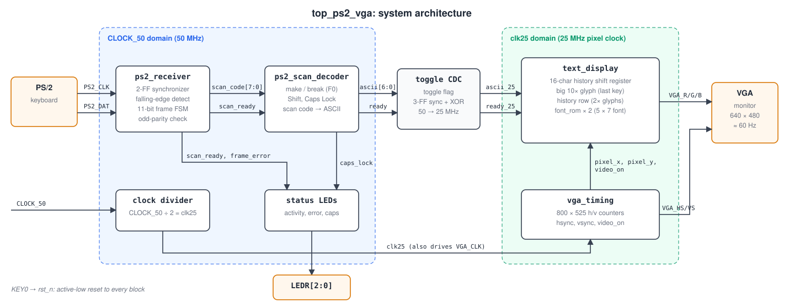
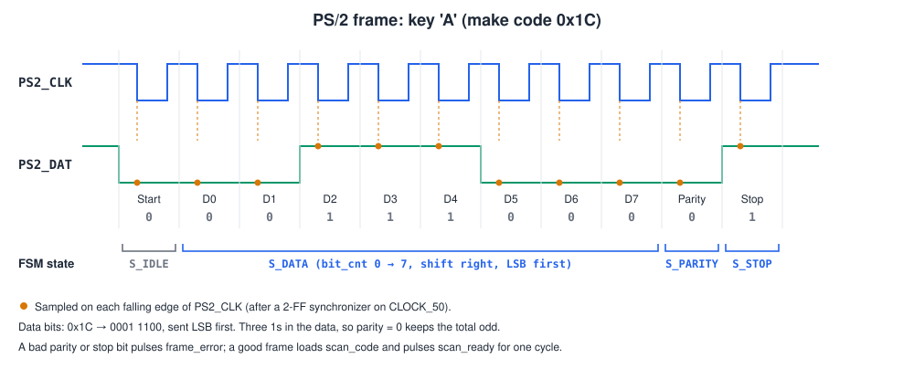
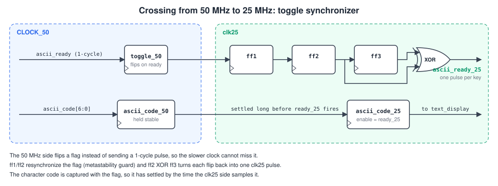
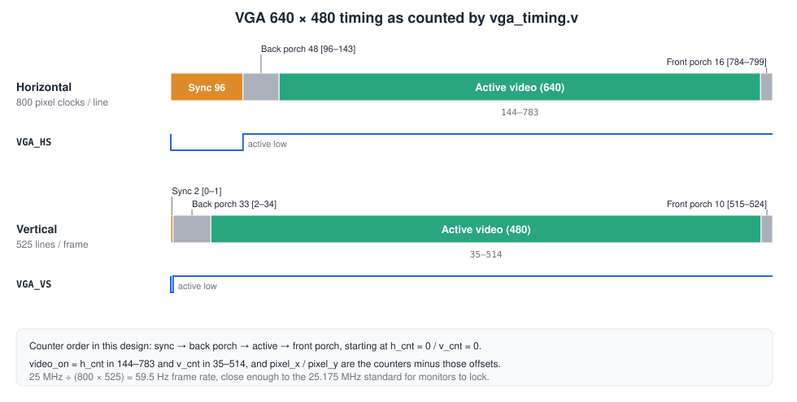
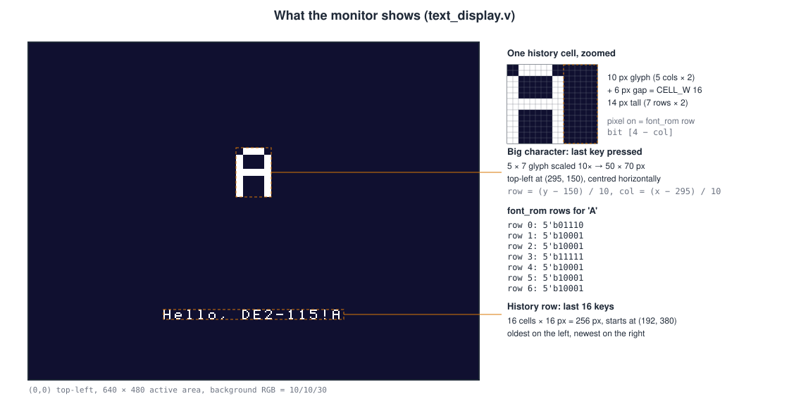

# PS/2 Keyboard to VGA Character Display on FPGA

A Verilog design for the **Terasic DE2-115** (Intel/Altera Cyclone IV E `EP4CE115F29C7`) that reads keystrokes from a **PS/2 keyboard** and draws them on a **640 × 480 VGA monitor**. The last key you press appears as a large character in the middle of the screen, and a row underneath keeps the last 16 keys. Shift and Caps Lock work, and three board LEDs show keyboard activity, frame errors, and Caps Lock state.

> 📷 _Photo of the board and monitor coming soon._

> 🎥 **Demo video:** _link coming soon_ 

---

## Contents

- [Features](#features)
- [How it works](#how-it-works)
  - [System architecture](#system-architecture)
  - [1. PS/2 receiver](#1-ps2-receiver-ps2_receiverv)
  - [2. Scan-code decoder](#2-scan-code-decoder-ps2_scan_decoderv)
  - [3. Crossing into the pixel clock](#3-crossing-into-the-pixel-clock-top_ps2_vgav)
  - [4. VGA timing](#4-vga-timing-vga_timingv)
  - [5. Text display and font ROM](#5-text-display-and-font-rom-text_displayv-font_romv)
- [Repository layout](#repository-layout)
- [Hardware and pin assignments](#hardware-and-pin-assignments)
- [Build and run](#build-and-run)
- [Using it](#using-it)
- [Author](#author)

---

## Features

- PS/2 receiver with a 2-flip-flop input synchronizer, falling-edge detection, an 11-bit frame state machine, and odd-parity and stop-bit checking
- Scan Code Set 2 to ASCII decoding for letters, digits, punctuation, and space, with make/break (`F0`) and extended (`E0`) prefix handling
- Shift (left and right) and Caps Lock, where Caps Lock only affects letters, like a real keyboard
- A toggle-based clock-domain crossing from the 50 MHz keyboard logic to the 25 MHz pixel clock
- 640 × 480 VGA output at about 60 Hz from a 25 MHz pixel clock
- A 5 × 7 bitmap font ROM with 92 glyphs (A–Z, a–z, 0–9, and common symbols)
- On-screen layout with one large 10× character and a 16-character history line
- Debug LEDs: `LEDR[0]` activity, `LEDR[1]` frame error, `LEDR[2]` Caps Lock

---

## How it works

### System architecture



The design has two clock domains:

| Domain | Clock | Blocks |
|---|---|---|
| Keyboard side | `CLOCK_50` (50 MHz, board oscillator) | `ps2_receiver`, `ps2_scan_decoder`, status LEDs |
| Video side | `clk25` (25 MHz, `CLOCK_50` divided by 2) | `vga_timing`, `text_display`, `font_rom` |

A keystroke travels left to right through the diagram. The keyboard shifts out an 11-bit serial frame. `ps2_receiver` turns that into an 8-bit scan code, and `ps2_scan_decoder` turns scan codes into ASCII. A toggle synchronizer hands each character safely to the 25 MHz domain, where `text_display` stores it and draws it at the pixel coordinates supplied by `vga_timing`.

`KEY0` is the active-low reset for every block.

---

### 1. PS/2 receiver (`ps2_receiver.v`)



The keyboard drives both `PS2_CLK` (about 10–16 kHz) and `PS2_DAT`. Each frame has 11 bits: a start bit (0), 8 data bits sent LSB first, an odd-parity bit, and a stop bit (1). The data is valid on the **falling edge** of the PS/2 clock.

The receiver works like this:

1. **Synchronize.** Both PS/2 lines are asynchronous to `CLOCK_50`, so each goes through two flip-flops to avoid metastability.
2. **Detect falling edges.** A one-cycle `ps2_clk_falling` strobe is produced when the synchronized clock was 1 on the previous cycle and is 0 now.
3. **Run the frame FSM** on each falling edge:

| State | Action on falling edge |
|---|---|
| `S_IDLE` | If `PS2_DAT` is 0 (start bit), clear the shift register and parity, then go to `S_DATA` |
| `S_DATA` | Shift the bit into `shift_reg` from the MSB side (so the LSB ends at bit 0), XOR it into `parity_calc`, and move to `S_PARITY` after 8 bits |
| `S_PARITY` | Data XOR parity bit must be 1 (odd parity). If not, pulse `frame_error` and go back to `S_IDLE` |
| `S_STOP` | If the stop bit is 1, load `scan_code` and pulse `scan_ready` for one cycle. Otherwise pulse `frame_error` |

---

### 2. Scan-code decoder (`ps2_scan_decoder.v`)

A PS/2 keyboard (Scan Code Set 2) does not send ASCII. It sends a **make code** when a key goes down and a **break code** (`F0` followed by the make code) when it comes up. Some keys add an `E0` prefix.

| Byte sequence | Meaning | What the decoder does |
|---|---|---|
| `1C` | `A` pressed | Emits ASCII (`a` or `A`) and pulses `ascii_ready` |
| `F0 1C` | `A` released | Ignored (no repeat character) |
| `12` / `59` | Left / right Shift pressed | Sets `shift_held` |
| `F0 12` / `F0 59` | Shift released | Clears `shift_held` |
| `58` | Caps Lock pressed | Toggles `caps_lock` |
| `E0 xx` | Extended key (arrows, etc.) | Ignored |

The upper/lower-case choice is:

```verilog
use_shift = shift_held ^ (caps_lock && is_letter);
```

So Caps Lock only changes letters, Shift inverts Caps Lock for letters, and Shift on a digit or symbol key gives the shifted symbol (`1` becomes `!`, `[` becomes `{`, and so on).

---

### 3. Crossing into the pixel clock (`top_ps2_vga.v`)



`ascii_ready` is a single 20 ns pulse at 50 MHz. The 25 MHz domain could miss a pulse that short, and sampling it directly would also risk metastability. The top level uses a **toggle synchronizer** instead:

1. On the 50 MHz side, each `ascii_ready` flips `ascii_toggle_50` and captures the character into `ascii_code_50`.
2. On the 25 MHz side, the toggle goes through three flip-flops. `ff2 XOR ff3` is high for exactly one `clk25` cycle after each flip, which gives `ascii_ready_25`.
3. `ascii_code_25` is loaded on that pulse. By then `ascii_code_50` has been stable for several cycles, so the 7-bit bus can be read safely without synchronizing each bit.

---

### 4. VGA timing (`vga_timing.v`)



Two counters run on `clk25`. `h_cnt` counts 0–799 pixel clocks per line, and `v_cnt` counts 0–524 lines per frame.

| | Sync | Back porch | Active | Front porch | Total |
|---|---|---|---|---|---|
| Horizontal (clocks) | 96 | 48 | 640 | 16 | 800 |
| Vertical (lines) | 2 | 33 | 480 | 10 | 525 |

- `hsync` / `vsync` are active low during the sync interval.
- `video_on` is high only inside the 640 × 480 active window.
- `pixel_x` and `pixel_y` are the counters minus the sync and back porch, so they run 0–639 and 0–479. They are registered, so they are one `clk25` cycle behind the raw counters.
- The frame rate is 25 MHz ÷ (800 × 525) ≈ **59.5 Hz**. The VGA standard uses 25.175 MHz, but monitors lock to 25 MHz without trouble.

On the DE2-115, the ADV7123 video DAC also needs `VGA_CLK` (driven by `clk25`), `VGA_BLANK_N` (driven by `video_on`), and `VGA_SYNC_N` (tied low).

---

### 5. Text display and font ROM (`text_display.v`, `font_rom.v`)



**Character storage.** A 16-entry shift register `history[0:15]` holds the last 16 characters. Each `ascii_ready_25` shifts everything along by one and puts the new character in `history[0]`. `last_char` also keeps the newest character for the big display.

**Font.** `font_rom` is a combinational lookup: give it a 7-bit ASCII code and a row number (0–6) and it returns 5 pixel bits for that row. Bit 4 is the leftmost column. Characters that are not in the ROM come out blank.

**Drawing.** For every pixel, `text_display` works out whether it falls in one of two regions:

| Region | Position | Size | Scale | Lookup |
|---|---|---|---|---|
| Big character | (295, 150) | 50 × 70 px | 10× | `row = (y − 150) / 10`, `col = (x − 295) / 10` |
| History row | (192, 380) | 16 cells × 16 px = 256 × 14 px | 2× | each cell is a 10 px glyph plus a 6 px gap |

A pixel is lit when the matching font bit `pixels[4 − col]` is 1. Lit pixels are white (`FF FF FF`), and the background is dark navy (`10 10 30`). Outside the active window, RGB is forced to 0 as VGA requires.

---

## Repository layout

```
.
├── rtl/
│   ├── top_ps2_vga.v        # top level: clock divider, CDC, LEDs, wiring
│   ├── ps2_receiver.v       # PS/2 serial frame receiver
│   ├── ps2_scan_decoder.v   # scan code set 2 → ASCII, Shift / Caps Lock
│   ├── vga_timing.v         # 640 × 480 sync and pixel counters
│   ├── text_display.v       # character history and pixel generation
│   └── font_rom.v           # 5 × 7 bitmap font
├── quartus/
│   ├── top_ps2_vga.qpf      # Quartus project file
│   └── top_ps2_vga.qsf      # device and DE2-115 pin assignments
└── docs/
    └── images/              # diagrams used in this README
        └── photos/          # board and monitor photos
```

---

## Hardware and pin assignments

**You need:**

- Terasic DE2-115 board and its USB-Blaster cable
- A PS/2 keyboard (or a USB keyboard that supports PS/2 through a passive adapter)
- A VGA monitor and cable
- Intel Quartus Prime 

**Pin assignments** (from `quartus/top_ps2_vga.qsf`):

| Signal | Pin(s) | I/O standard | Notes |
|---|---|---|---|
| `CLOCK_50` | `PIN_Y2` | 3.3-V LVTTL | 50 MHz oscillator |
| `KEY0` | `PIN_M23` | 2.5 V | Push-button reset, active low |
| `PS2_CLK` | `PIN_G6` | 3.3-V LVTTL | PS/2 port clock |
| `PS2_DAT` | `PIN_H5` | 3.3-V LVTTL | PS/2 port data |
| `VGA_R[7:0]` | `H10 H8 J12 G10 F12 D10 E11 E12` | 3.3-V LVTTL | MSB first |
| `VGA_G[7:0]` | `C9 F10 B8 C8 H12 F8 G11 G8` | 3.3-V LVTTL | MSB first |
| `VGA_B[7:0]` | `D12 D11 C12 A11 B11 C11 A10 B10` | 3.3-V LVTTL | MSB first |
| `VGA_HS` / `VGA_VS` | `PIN_G13` / `PIN_C13` | 3.3-V LVTTL | Sync, active low |
| `VGA_CLK` | `PIN_A12` | 3.3-V LVTTL | 25 MHz to the DAC |
| `VGA_BLANK_N` / `VGA_SYNC_N` | `PIN_F11` / `PIN_C10` | 3.3-V LVTTL | DAC control |
| `LEDR[0]` / `[1]` / `[2]` | `PIN_G19` / `PIN_F19` / `PIN_E19` | 2.5 V | Status LEDs (`LEDR[17:3]` held at 0) |

---

## Build and run

1. Clone the repository:
   ```bash
   git clone https://github.com/<your-username>/ps2-vga-character-display.git
   ```
2. Open `quartus/top_ps2_vga.qpf` in Quartus Prime.
3. Run **Processing → Start Compilation**.
4. Connect the DE2-115 over USB-Blaster, open **Tools → Programmer**, and load `quartus/output_files/top_ps2_vga.sof`.
5. Plug in the keyboard and monitor, press `KEY0` to reset, and start typing.

---

## Using it

| You do | You see |
|---|---|
| Press a letter, digit, or symbol | It appears large in the centre and is added to the right end of the history row |
| Hold Shift | Upper-case letters and shifted symbols (`!@#$%^&*()_+{}:"<>?~`) |
| Press Caps Lock | Letters switch case and `LEDR[2]` lights |
| Any key | `LEDR[0]` toggles once per received byte |
| A corrupted frame | `LEDR[1]` latches on until you press `KEY0` |

---

> 📷 _More photos coming soon._

---

## Author

**Parag Jibhakate** (26MVD0053)

**Hardik Malgaonkar** (26MVD0049)

**Sivajyothik M** (26MVD0048)

<!-- Fill in or delete the lines below -->
- Course: Digital System Design with FPGA (MAVLD503)
- Institution: Vellore Institute of Technology, Vellore, TamilNadu, India
- Term: Fall Semester 2026-27

Built with Verilog HDL and Intel Quartus Prime for the Terasic DE2-115.
